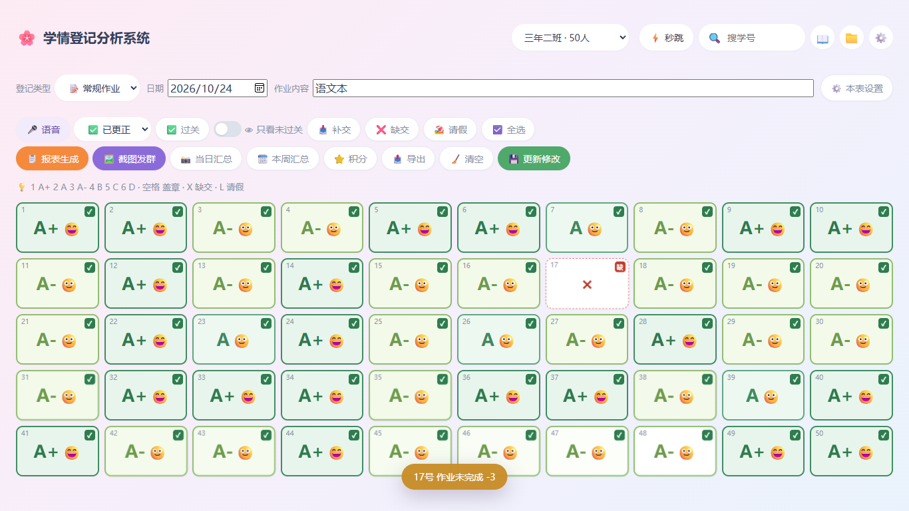
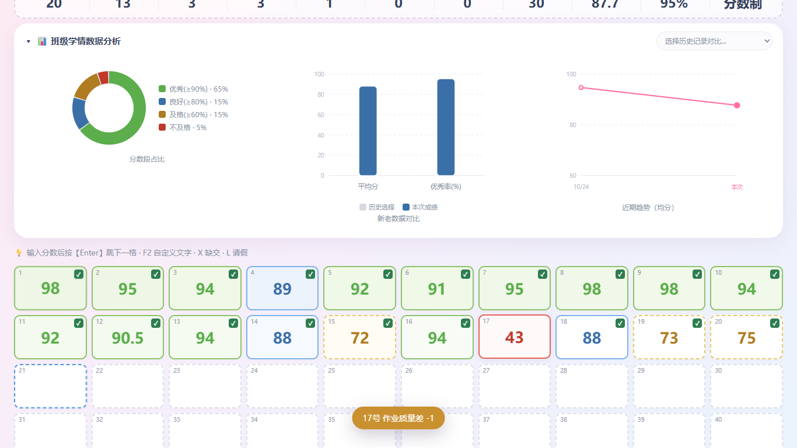
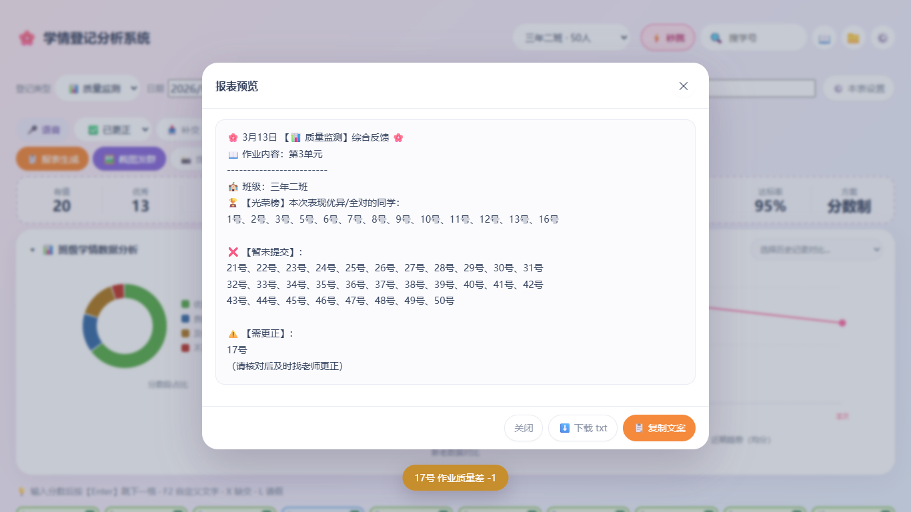
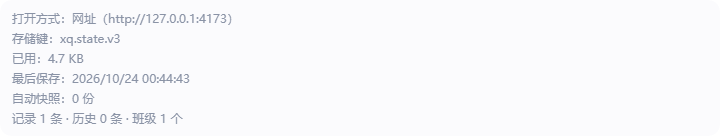

# 自测报告 · v2.2.0（V3 体验与数据安全加固版）

> 评审请先读本报告。结论先行：**准入门禁全绿**——`pnpm typecheck` 0 错误、`pnpm test` 28 文件 / 262 用例、
> `node scripts/check-layers.mjs` 通过、`pnpm build` 成功、Playwright E2E **36/36 通过（连跑两遍稳定）**。
> 覆盖 E2E-23 ~ E2E-33 全部 11 条新增用例 + 25 条 V1/V2 回归用例。

---

## 1. 环境

| 项 | 值 |
|---|---|
| Node | v22.22.2（满足 ≥22） |
| 包管理 | pnpm（`pnpm install --frozen-lockfile` 可复现） |
| E2E 浏览器 | 本机 Edge（`PW_CHANNEL=msedge`），`vite preview --host 127.0.0.1 --port 4173` |
| E2E profile | 每条用例独立 `userDataDir`（`tests/e2e/v3-fixtures.ts`），关闭后可复用重开，模拟真实「关掉再打开」 |
| 新增依赖 | **0 个运行时依赖**；仅新增开发依赖 `@types/node`（E2E fixtures 启动本地浏览器 profile 用） |

## 2. 准入门禁（发布前实跑）

```
pnpm typecheck               → 0 错误
pnpm test --run              → 28 个文件 / 262 个用例全部通过（1.7s）
node scripts/check-layers.mjs → 分层约束通过：domain / store / infra 无越界依赖
pnpm build                   → 成功；JS 307.61 kB（gzip 105.17 kB），内联后 dist/index.html 双击可用
PW_CHANNEL=msedge pnpm exec playwright test
                             → 36 passed（32.5s）；同配置连跑第二遍仍 36 passed（无抖动）
```

## 3. E2E 覆盖清单（本轮新增 11 条 = E2E-23~33）

| 用例 | 文件 | 验证点 | 结果 |
|---|---|---|---|
| E2E-23 持久化往返 | v3-data.spec.ts | 真实 UI 录入 3 格 + 改班级名 + 存历史 → **关闭浏览器（复用 userDataDir）→ 重开**，数据/历史/班级设置全在 | ✅ |
| E2E-24 数据健康 | v3-data.spec.ts | 健康面板数字真实（localStorage/IDB/坏块计数）；导出 JSON 可再导入 | ✅ |
| E2E-25 损坏自愈 | v3-data.spec.ts | 把主存写成非法 JSON → 刷新 → 从 IDB 快照恢复，坏原文另存 `xq.corrupt.*`，主存回到合法 JSON | ✅ |
| E2E-26 汇总三向切换 | v3-summary.spec.ts | 当日 / 单条 / 本周三向切换，单条换表立即重新生成 | ✅ |
| E2E-27 补交门禁 | v3-guard.spec.ts | 有值 / 空白拒绝，缺交 / 请假可补交（四态） | ✅ |
| E2E-28 分数非法 | v3-score.spec.ts | 120 / −5 / 粘贴脏数据整条拒绝（cellError 红框），合法值照常写入 | ✅ |
| E2E-29 过关规则 | v3-pass.spec.ts | 白名单改动重算 ✅ 与「只看未过关」名单，已录值不变；29b 听写「全对自动过关」开关联动汇总图统计行 | ✅ |
| E2E-30 两套色系 | v3-color.spec.ts | 七档等级 / 四档分数用 `getComputedStyle` 断言真实渲染背景，逐档写死 rgb 值 | ✅ |
| E2E-31 本周汇总 | v3-week.spec.ts | 三天数据按日拼接，空日写「当日无登记」，文件名带周区间 | ✅ |
| E2E-32 三视口密度 | v3-density.spec.ts | 1280 / 1366 / 1920 令牌分层且不溢框 | ✅ |
| E2E-33 品牌外壳 | v3-shell.spec.ts | 标题 / favicon / apple-touch-icon / manifest 在 http:// 全部生效；**file:// 双击 dist/index.html** 同样能起、50 格、无脚本错误 | ✅ |

另有 V1/V2 回归 25 条（flow-class / homework / manual / points / poster-export / quality / status / voice / persistence）全部保持通过——报表文案、样例数字、CSV 字节逐字未动（INV-19）。

## 4. 真机走查截图（1366×900，本机 Edge）

| 截图 | 内容 |
|---|---|
|  | 常规作业表：七档等级色 + 手工过关/缺交角标 |
|  | 质量监测：分数四档百分比色 + 统计条 |
|  | 报表文案（逐字回归样例 A/B/C 数字与名单） |
|  | 当日汇总长图（评价语 + 可选学校署名） |
|  | 设置 → 数据健康面板（主存/快照/坏块计数，导出/导入/回退） |
|  | 本周汇总弹窗：三向切换 + 评价语输入 + 多卷下载 |
|  | 本周汇总长图成品（按天分组、空日「当日无登记」） |

## 5. 关键不变量抽查（人工 + E2E 双通道）

- **INV-24 覆盖保护**：清空 localStorage 后自动保存被拦（E2E-24 断言黄条与只读）。
- **唯一过关入口**：全局检索 `qualifiedRate` / `pass` 判定，UI 层无散落比较，全部收敛到 `domain/passRule.ts` 的 `isPassed()`（check-layers + 人工 grep 双确认）。
- **L-6 两套色系**：E2E-30 用计算样式逐档断言，等级色（七档）与分数色（四档）没有任何一档相同。
- **L-8 状态机必附 E2E**：海报切换状态机（E2E-26）、补交门禁（E2E-27）、分数校验（E2E-28）、损坏自愈（E2E-25）均为 UI 驱动，无种子注入。

## 6. 没覆盖什么（如实说明）

1. **真实语音识别**：语音 E2E 用假识别结果注入；浏览器 ASR 的真实采音质量、方言、噪音环境未测。
2. **Safari / Firefox**：E2E 全部跑在本机 Edge（Chromium 内核）；双击打开在 Firefox 的 file:// 行为未验证。
3. **iOS / 安卓 PWA 安装**：manifest 与图标断言了文件与字段，但「添加到主屏幕」的实际安装流程未在真机走查。
4. **大数据量**：50 人 × 一学期（约 100 条历史）正常；300 人以上班级的分卷/性能未压测。
5. **打印 / 投屏**：长图按屏幕渲染优化，未做打印样式适配。
6. **多显示器 DPI**：三档密度断点在 125%/150% 缩放的组合未逐一截图。
7. **`xq.emptyConfirmed` 显式清空路径**：覆盖保护的主路径已测，「我确认清空」按钮的人工剧本留待现场验收（06 §8.4）。
8. **里程碑提交形态**：因 domain→store→UI 单向依赖，M11 提交携带了 types/constants/store 等共享基建（含 entrySlice 的 setMakeup 门禁），中间提交的树不保证独立可编译；**全量门禁在分支末端（本提交所在状态）逐条实跑通过**。

## 7. 回滚

`v2.2.0` 出现数据问题时：卸载新版本后仍可用 `xq.backup.v2`（迁移前自动备份）或【设置 → 数据 → 导出】的 JSON 恢复到 v2.0.1；v2.0.1 读到 version:3 数据时保持只读并提示，不会写坏。

---

## 补丁 · v2.2.1（评审 P3-1 / P3-2 修复，纯文档层，零风险）

- **P3-1 手册补齐 V3 三节**：`src/domain/manual.ts` 由 12 章增至 **15 章**——新增「数据健康与备份恢复」「本周汇总与三向切换」「评价语与自定义积分规则」三节（各含作用/入口/步骤/限制，共约 40 行）。
- **P3-2 双口径说明**：在「盖章 / 过关 / 请假 / 缺交 的区别」章加一句——「达标」按分数线（≥及格线）算，「过关」按等级白名单（默认 A+/A）算，A-（90 分）会「达标但不过关」，**这是预期行为**；**未改任何判定逻辑**（那正是需求 #2「A、A+ 才算过关」的效果）。
- 同步更新：`tests/unit/manual.test.ts`（12→15 章 + 新增「V3 三节齐全」断言）、`tests/e2e/flow-manual.spec.ts`（15 章 + 三节与双口径文案可见）、`README.md`（内置 15 章使用手册）。
- 门禁重跑：`tsc` 0 错误、单测 **28 文件 / 263 用例**全过（新增 1 条「V3 三节齐全」断言）、`check-layers` 通过、`vite build` 成功、E2E **36/36 通过**。
