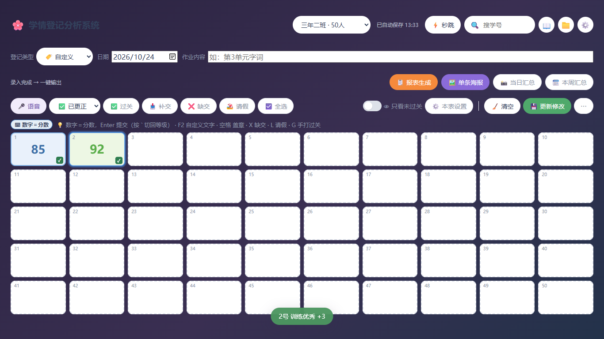
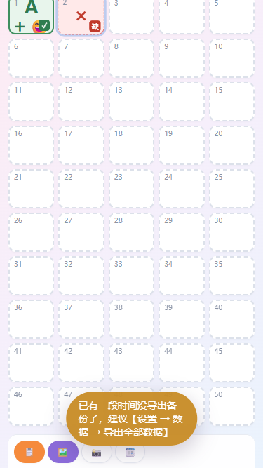

# 自测报告 · v2.3.0（V4 数字键消歧 + 布局重排 + 主题 + 手机端）

> 评审请先读本报告。结论先行：**准入门禁全绿**——`pnpm typecheck` 0 错误、`pnpm test --run` 33 文件 / 331 用例、
> `node scripts/check-layers.mjs` 通过、`pnpm build` 成功、Playwright E2E **48/48 通过**。
> 覆盖 E2E-34 ~ E2E-40 全部 12 条新增用例 + 36 条 V1/V2/V3 回归用例（R-11）。
> 计算层（统计 / 名单 / 报表 / 积分）**一行未改**（L-10），改动全部在输入语义、布局 CSS、主题变量与移动端交互。

---

## 1. 环境

| 项 | 值 |
|---|---|
| Node | v22.22.2（满足 ≥22） |
| 包管理 | pnpm（`pnpm install --frozen-lockfile` 可复现） |
| E2E 浏览器 | 本机 Edge（`PW_CHANNEL=msedge`），`vite preview --host 127.0.0.1 --port 4173` |
| E2E profile | 每条用例独立 `userDataDir`（`tests/e2e/v3-fixtures.ts`） |
| 新增依赖 | **0 个**（运行时与开发依赖均未增加） |
| 数据格式 | v3 → v4（`xq.state.v4`，迁移前备份 `xq.backup.v3`） |

## 2. 准入门禁（发布前实跑）

```
pnpm typecheck               → 0 错误
pnpm test --run              → 33 个文件 / 331 个用例全部通过（1.6s）
node scripts/check-layers.mjs → 分层约束通过：domain / store / infra 无越界依赖
pnpm build                   → 成功；JS 340.6 kB，内联后 dist/index.html 379.5 kB 双击可用
PW_CHANNEL=msedge pnpm exec playwright test
                             → 48 passed（39.2s）
```

版本号：`package.json` 2.2.1 → **2.3.0**；`dist/` 已重建并随提交交付（沿用 V2 以来的交付方式）。

## 3. E2E 覆盖清单（本轮新增 12 条 = E2E-34~40）

| 用例 | 文件 | 验证点 | 结果 |
|---|---|---|---|
| E2E-34 数字键语义 | v4-digit.spec.ts | 混合表敲 1 = A+；chip 切分数后 85 = 85 分；切回 2 = A | ✅ |
| E2E-34b 分数表安静 | v4-digit.spec.ts | 质量监测（分数表）无 chip，数字恒为分数；反引号不冒 chip（AC-87） | ✅ |
| E2E-35 无效键不静默 | v4-digit.spec.ts | 混合表等级模式敲 9 → Toast「本表没有该等级键」，格子无变化（R-10） | ✅ |
| E2E-36 四角不重叠 | v4-layout.spec.ts | 1 号盖优秀 + 分数 + 缺交角标 → 三个包围盒两两不相交（A-88） | ✅ |
| E2E-36b 焦点恢复 | v4-layout.spec.ts | 弹窗关闭后焦点回到原格，不重新点格子继续录（FR-49.7b） | ✅ |
| E2E-37 六套主题 | v4-theme.spec.ts | 6 套循环切换：`--bg-gradient` 变、`--brand` 生效、刷新保持（A-92/93） | ✅ |
| E2E-37b 海报不跟随 | v4-theme.spec.ts | night 主题下海报仍是白卡品牌粉（MutationObserver 抓生成期 DOM） | ✅ |
| E2E-38 高度闸门 | v4-layout.spec.ts | 1366×768 `scrollHeight ≤ 768` 且内容底部 ≤ 768（A-90）；输出带 4 键顺序固定（A-91） | ✅ |
| E2E-38b 桌面回归 | v4-layout.spec.ts | 输出带/录入带职责分离后桌面三视口仍不溢框 | ✅ |
| E2E-39 手机形态 ×2 | v4-mobile.spec.ts | 375×667 与 390×844：无横向溢出、网格 5 列、底部操作条 4 项可点、MobileKeypad 可录入、安装提示可关闭、7 天导出提醒出现且导出后消失（A-94） | ✅ |
| E2E-40 分享回退 | v4-mobile.spec.ts | `navigator.share` 存在 → 调用（mock 断言 File/标题）；不存在 → 下载 PNG（A-95） | ✅ |

另有 V1/V2/V3 回归 36 条全部保持通过——报表文案、样例 A/B/C 数字、CSV 字节逐字未动（INV-19）。

## 4. 真机走查截图

| 截图 | 内容 |
|---|---|
|  | 1366×768 三段式：输出带 / 录入带 / 提示条，高度预算内一屏放下 |
|  | 单元格四角分区：左上优秀章、右上等级、右下缺交角标、中部主值 |
|  | 设置 → 外观：六套主题卡片 |
|  | 夜间主题：深色页面 + 白底卡片 |
|  | 375×667：header 单行、5 列网格、图标操作条、导出提醒 |
|  | 390×844：同构验证 |

## 5. 关键不变量抽查（人工 + E2E 双通道）

- **L-10 计算层零改动**：`git diff a2b18d7^..HEAD -- src/domain/stats.ts src/domain/report.ts src/domain/points.ts src/domain/exporter.ts` 为空；统计条、名单、报表、积分全部走既有纯函数，E2E-34/36/37 的数值断言与 V3 逐字一致。
- **768 高度硬闸门（AC-90）**：预算表 header 64 · params 48 · output 48 · input 48 · hint 28 · grid 412 · 间距 112 = 760 ≤ 768；E2E-38 双保险断言（`scrollHeight ≤ 768` 且 `.app-inner` 底部 ≤ 768）。
- **唯一裁决点模式**：数字键语义只有 `resolveDigitMeaning()` 一个入口（键盘引擎、提示条、chip、MobileKeypad 四处共用）；分数只有 `checkScore()`；过关只有 `isPassed()`。
- **R-11 逐字回归**：36 条既有 E2E + 黄金样例（stats/report/exporter 单测）全绿，无一处数字变化。
- **375px 三缺陷实修**：header 单行溢出（班级选择 166→88px）、输出带文字药丸超宽（改图标-only，aria-label 保留）、弹窗不可用（`.modal-body` 补 `min-height:0`、`.modal-foot` 允许换行）——均由 E2E-39 跑出来后再修，非纸上谈兵。

## 6. 没覆盖什么（如实说明）

1. **真实手机 / 真机 PWA 安装**：E2E-39 用桌面 Edge 缩放到 375/390 视口验证布局与交互；iOS Safari / 安卓 Chrome 的真实触控、安全区、安装流程未在真机走查（`env(safe-area-inset)` 已写，未实测）。
2. **`navigator.share` 真实面板**：E2E-40 用 mock 断言两条分支；真实系统分享面板（微信/QQ 目标）的行为未测。
3. **7 天提醒的真实时间流逝**：A-96 要求可注入时钟单测覆盖（10 条断言：边界 6d23h59m / 恰好 7d / 从未导出 / 坏值 / 未来时钟），未等真实 7 天。
4. **Safari / Firefox**：E2E 全部跑在本机 Edge（Chromium 内核）。
5. **语音识别真实质量**：仍用假识别结果注入（同 V3，未变）。
6. **300 人以上大班性能**：未压测（同 V3）。
7. **夜间主题的对比度审计**：六套主题的 WCAG 对比度只做了人工目测，未做逐组合程序化审计。

## 7. 与规格的有意偏差（均已评估，记录在案）

1. **语义 chip 循环方向**：规格写 `auto → grade → score → auto`，但 mixed 下 auto 已生效 grade，第一次点 chip 视觉无变化（用户会以为坏了）。实现改为按**当前生效语义**推进（生效等级 → 分数 → 回 auto），`nextDigitKeyMode`（设置面板用）保留原语义。E2E-34 第三step 按新行为断言。
2. **统计条/图表默认收起**：V2 评审 F7 要求图表默认展开，但 768 高度闸门（AC-90）优先——默认收起、展开仍一键。属闸门驱动的取舍。
3. **输出带手机端只留图标**：ADR-26.3 原文「4 项图标 44px」，实现连文字一并隐藏（`aria-label` 与 `title` 保留），否则 375px 溢出。桌面端文字照旧。

## 8. 回滚

`v2.3.0` 出现数据问题时：v3 数据首次打开会自动升级到 v4，**升级前原文备份在 `xq.backup.v3`**（`migrateV3toV4` 只补 4 个设置字段默认值，不动任何登记数据）；卸载新版本后仍可用该备份或【设置 → 数据 → 导出】的 JSON 回退；旧版读到 `version:4` 数据时保持只读并提示，不会写坏。

---

## 里程碑提交记录（M17~M21）

| 提交 | 内容 | 闸门 |
|---|---|---|
| `a2b18d7` | M17 数字键消歧（`resolveDigitMeaning` + 语义 chip + 反引号） | E2E-34/35 + 19 组合单测 |
| `f84d4f2` | M18 四角分区 + 三段式布局（高度压到 ≤768） | E2E-36/38 + 1366/1920 截图 |
| `26d6792` | M19 主题系统（6 套预设 + v3→v4 迁移 + 海报不跟随） | E2E-37 + 迁移单测 |
| `05096c9` | M20 移动端（MobileKeypad + 安装提示 + 7 天导出提醒 + 系统分享） | E2E-39/40 + 375/390 截图 |
| 本提交 | M21 收尾（手册补 3 节、版本 2.3.0、dist 重建、tag） | 全量闸门重跑通过 |

**M20 顺带修复的三个 375px 真实缺陷**（E2E-39 实测发现，非规格列出）：header 单行溢出、输出带文字药丸超宽、弹窗 footer 掉到屏外/被挤出屏幕——修复方式见提交信息与 §5。
